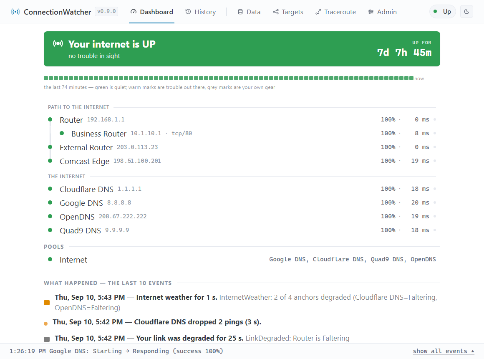

# ConnectionWatcher

[](https://github.com/mdraughn/ConnectionWatcher/actions/workflows/ci.yml)
[](LICENSE)

A home internet connectivity monitor. It pings a hierarchy of targets — LAN
devices, the router, the cable modem, upstream ISP hops, and external anchors
like Google and Cloudflare — and answers the question *"is my internet down,
and what kind of down is it?"*: a single site's incident, general internet
weather, or your own link.



When your connection *is* the problem, ConnectionWatcher tells you which hop
broke, keeps the evidence (a printable ISP report with timestamps your
provider can correlate), and can page you through Home Assistant, MQTT, or
webhooks. When it isn't, it says so — a Netflix outage should never send you
to reboot your modem.

## Quick start (Docker)

```bash
docker run -d --name conwatch --restart unless-stopped \
  -p 8080:8080 -v ./data:/app/data --cap-add NET_RAW \
  ghcr.io/mdraughn/conwatch:latest
```

Open `http://localhost:8080` — the quick-setup wizard detects your router,
offers four public DNS anchors, and starts monitoring in one click. The image
is multi-arch (amd64 + arm64: Intel/ARM Synology, Raspberry Pi, any Linux);
`deploy/docker/compose.yaml` has the same thing in compose form. On Windows,
`.\Install-Watcher.ps1` installs it as a service instead — see
[Running unattended](#running-unattended).

## Running from source

```powershell
dotnet run --project Programs/ConWatch
```

- The SQLite database lives at `data/conwatch.db` (relative to the working
  directory; configurable via `Persistence:DbPath`). Schema migrations apply
  automatically at startup.
- Configuration (targets, profiles, pools) lives **in the database** and is
  edited through the REST API under `/api/v1` — Swagger UI at `/swagger` in
  Development. On first boot, a `Watcher` section in appsettings.json (if
  present) seeds the config; after that the DB is the source of truth.
- The verdict layer (`Verdict:AnchorPool`) names the pool whose members act as
  internet anchors; with intermediates healthy, one degraded anchor is a
  SiteIncident, two or more (configurable) is InternetWeather.

## First run

With an empty configuration, ConWatch opens the **quick-setup wizard**: it
detects your router (confirm it — inside a container the detected gateway may
be the container bridge), offers four public anycast DNS anchors, optionally
discovers your router's WAN address via UPnP, and starts monitoring with one
click. The **Admin** page holds database stats, retention/verdict settings,
and the danger zone (clear history / factory reset, type-to-confirm).

Restarts are warm: after an update, reboot, or config change, ConWatch resumes
its last known states immediately (shown as *assumed* and burst-confirmed by
fresh pings within seconds) instead of re-measuring the world from scratch —
the timelines stay continuous and no restart noise is recorded. Seeding from
the database applies only when the watcher was down briefly (the
`Engine.WarmRestartMaxGapMinutes` setting, default 10 minutes; 0 disables).

## Web UI

ConWatch serves its UI at the root:

- **Dashboard** (`/`) — verdict banner, live reachability tree (SignalR)
  with per-target success rate and latency at a glance. Bottom status bar
  shows the latest event.
- **Dashboard story** — around the live tree: the **event strip** (the last
  N minutes as one row of minute bins right under the verdict banner), the
  **incident ledger** (the 10 most recent events, each as one plain-English
  sentence — "Your link went down for 4 min. LinkDown: Comcast — Comcast
  Edge is Down"), and the recent-glitch list. All displays share one
  encoding: shape = scope (bar = shared path, dot = one site), hue = whose
  gear (warm = out there, grey = yours), depth = severity (glitch →
  degraded → out).
- **History** (`/History`) — the evidence: uptime stats, latency band, loss
  chart, per-subject state ribbon, the **recurrence punchcard** (hours ×
  days over 30 days; a nightly gremlin reads as a horizontal run), the
  **cause-aligned ribbon board** — every target on one shared axis, trunk
  rows in grey, hatching for "unreachable behind a down parent", so one
  incident reads as a vertical stripe across exactly the rows it touched —
  and a 90-day incident ledger. Detection is aggressive: the first lost
  ping starts a 1-second-interval burst on that target AND a corroboration
  sweep across all anchors and the trunk, so even a few-second wobble yields
  enough evidence to classify.
- **Data** (`/Data`) — the record: database statistics, all exports
  (transitions/rollups/glitches as CSV or JSON, the sanitized snapshot
  document), the ISP report link, and the retention settings that keep the
  database from growing forever (minute rollups → hourly → daily).
- **Targets** (`/Config/Targets`, `/Config/Profiles`, `/Config/Pools`) — CRUD
  with inline validation errors, plus whole-config export/import. Targets can
  carry an optional **ISP/operator name** ("Comcast"): link verdicts then say
  "LinkDown: Comcast — External Router is Down", the ISP report titles itself
  with the provider, and the MQTT verdict attributes carry it. The setup
  wizard asks once ("Who is your internet provider?") and tags the WAN hop.
- **Traceroute** (`/Traceroute`) — discover upstream hops and add them as
  monitored targets with the right parent pre-filled.

Each target probes over **ICMP ping** by default, or a **TCP connect** to a
chosen port for devices that firewall ping but still run a service — a
refused connection still counts as a reply, since an RST proves the host's
stack answered. Private addresses (RFC1918, loopback, link-local) allow any
port; public addresses are restricted to 80, 443, 53, where a bare
connect-and-close looks like ordinary client traffic. The Targets form's
**Test** button tries ICMP and the policy-allowed TCP ports for the typed
address in one click and preselects whichever answered.

## Notifications (Home Assistant MQTT + webhooks)

Configured on the **Admin** page under *Notifications*; both are off by
default and reconfigure live — no restart needed.

**MQTT / Home Assistant** — enter your broker (host, port, optional
credentials), press *Test connection*, and enable. ConWatch publishes Home
Assistant discovery documents, so entities appear automatically under one
"ConnectionWatcher" device:

- a **verdict sensor** (`Healthy` / `SiteIncident` / `InternetWeather` /
  `LinkDown`, with the detail text as an attribute),
- an **internet up/down binary sensor** (OFF only when the verdict is
  LinkDown — the simplest summary),
- a **connectivity binary sensor per target** (ON while Responding, Faltering,
  or Recovering; OFF when Down or Unreachable).

State topics are retained under the base topic (default `conwatch/…`), with a
last-will `availability` topic so entities show *unavailable* if ConWatch
stops. Every transition is also published as JSON to `conwatch/transitions`
for automations that want the raw events. Publishes happen only on state
changes and reconnects — never per ping.

**Heartbeat** — point `Heartbeat.Url` at a dead-man's-switch service
(healthchecks.io or self-hosted) and ConnectionWatcher GETs it every few
minutes to say "still alive"; the service alerts you when the pings stop —
a dead NAS, a crashed container, or a full internet outage. Watches the
watchman.

**Webhooks** — one URL per line; each transition is POSTed as JSON
(`subjectKind`, `subjectName`, `from`, `to`, `trigger`, verdict/evidence
fields). Set *Verdict changes only* to be notified just when your internet
weather changes rather than on every target flap.

**Admin password** (optional) — set one on the Admin page to lock Config,
Admin, Traceroute, and Setup (pages and APIs) behind a single site password.
Watching stays open. A 🔒 button on the dashboard enters admin mode for the
browser session. It stops casual tinkering, not attackers: forgot the
password? Delete `admin-password.txt` next to the database
(`C:\ProgramData\DSoftCo\ConnectionWatcher\data\` on Windows, the mapped
`data/` folder on Docker/Synology) and reload.

Frontend dev loop: `npm run watch` in `Programs/ConWatch/ClientApp` beside
`dotnet run`; `npm test` runs the Vitest suite. `dotnet publish` builds the
bundles automatically.

## Moving to a new machine (clone + take over)

The setup wizard on a fresh install offers **"Copy everything from a running
ConnectionWatcher"**: enter the old node's URL (and its admin password, if
set) and the new node arrives with the full configuration, history, and —
over the authenticated channel — the notification secrets. It starts as a
**disabled read-only archive** while the old node keeps monitoring; verify it
looks right, then press **Take over** on its Admin page: the old node is
disabled, one final snapshot closes the data gap to seconds, and the new node
goes live (warm-started, so the timeline stays continuous). The old node
remains a browsable archive until you decommission it.

Transport honesty: cloning over plain HTTP to a non-local address sends the
password and receives secrets unencrypted — the wizard stops and offers the
HTTPS address, an explicit "send it anyway", or a secret-less clone. The
master switch behind all this is the **Monitoring** toggle on the Admin page
(`Engine.Enabled`): off = archive mode — history, reports, and exports keep
serving; pinging and notifications stop, and MQTT reads offline in Home
Assistant.

## Privacy

ConnectionWatcher has **no telemetry**: nothing phones home to the author or
anyone else — no usage analytics, no crash reporting, no version checks (if
an update check is ever added, it will be opt-in and documented here). The
complete list of network traffic the app can generate:

- ICMP pings and DNS lookups for the targets **you** configured (that's the
  product);
- only if you enable them, and only to endpoints you typed in: MQTT to your
  broker, webhooks to your URLs, the heartbeat ping;
- only when you trigger them: the setup wizard's router probe (your own
  gateway), traceroute, and clone/take-over calls to a node you named.

The web UI is self-contained — CSS, fonts, and scripts are served by the app,
so browsers make no third-party requests. Logging goes to stdout only (your
container's log, or Warning+ to the Windows Event Log as a service); nothing
is written to log files, credentials are never logged, and webhook/heartbeat
URLs appear in logs with their secret paths elided (`https://hc-ping.com/…`)
so a pasted log can't leak them.

## Ask Claude about your internet (MCP)

ConnectionWatcher exposes a Model Context Protocol endpoint at `/mcp`, so an
MCP host can query the node directly:

```bash
claude mcp add --transport http conwatch http://nas.example.com:8080/mcp
```

Then just ask — "how was my internet last night?", "any glitches today?",
"what did the verdict blame on Tuesday?" — and Claude answers from the actual
database via four read-only tools: `get_current_status`,
`get_connection_report`, `get_transitions`, and `get_glitches`. The endpoint
is open like the rest of the watching surface and serves nothing the open
APIs don't already serve; it never touches settings, secrets, or admin
actions.

## Grafana / Prometheus (metrics)

ConnectionWatcher exposes Prometheus metrics at `/metrics` — open like the
rest of the watching surface, and serving nothing `/api/v1/status` doesn't.
Scrape config:

```yaml
scrape_configs:
  - job_name: conwatch
    scrape_interval: 15s
    static_configs:
      - targets: ["nas.example.com:8080"]
```

What you get: `conwatch_verdict{state=...}` (one-hot — feed it straight to a
Grafana state-timeline panel), per-target `conwatch_target_up`,
`conwatch_target_loss_ratio` (packet loss, 0..1) and
`conwatch_target_rtt_seconds`, `conwatch_pool_up`, plus
`conwatch_transitions_total` and `conwatch_glitches_total` counters for
`rate()` panels. Useful starters:

```promql
conwatch_target_rtt_seconds * 1000            # per-target latency in ms
avg(conwatch_target_loss_ratio) * 100         # overall packet loss %
increase(conwatch_transitions_total[1h])      # instability by target
```

## Running unattended

**The easy way** — from the repo root, no parameters, self-elevating:

```powershell
.\Install-Watcher.ps1
```

```powershell
.\Install-Tray.ps1
```

`Install-Watcher` publishes to `C:\Program Files\DSoftCo\ConnectionWatcher\Watcher`,
installs the service (data in `C:\ProgramData\DSoftCo\ConnectionWatcher\data`),
and opens the dashboard. `Install-Tray` publishes the dot and points it at the
installed service automatically. `Publish-*` re-deploys after changes
(stopping/restarting the service or tray around the copy), `Build-*` is a
quick compile check, and `Uninstall-*` removes service/autostart while leaving
files and data in place.

**By hand** — publish anywhere and run the deploy scripts with parameters:

```powershell
dotnet publish Programs/ConWatch -c Release -o C:\ConWatch
powershell -ExecutionPolicy Bypass -File deploy/windows/install-service.ps1 -AppDir C:\ConWatch
```

The installer picks a free port once (default 8080; `-Port` to choose), pins
it, opens the firewall, sets restart-on-failure, creates a Start Menu
shortcut, starts the verdict-colored tray companion, and opens the dashboard.
`uninstall-service.ps1` removes everything except your data.

**Tray companion (standalone)** — the dot also installs on machines that
*aren't* running the server (point it at the NAS or another box):

```powershell
dotnet publish Programs/ConTray -c Release -o C:\ConTray
powershell -ExecutionPolicy Bypass -File deploy/windows/install-tray.ps1 -AppDir C:\ConTray -Url http://nas:8080
```

No elevation needed. Green/orange/red/gray at a glance; double-click opens the
dashboard; right-click for History, the ISP report, Admin, and **Settings**
(override the server URL, test the connection, return to the installed
default, toggle toast notifications on state changes).

**Reverse proxy / HTTPS** — ConWatch is proxy-friendly by construction: it
emits only relative URLs and never reads scheme, host, or client IP, so an
HTTPS-terminating proxy (e.g. Synology DSM's reverse proxy with the existing
cert) needs no app-side configuration. Two rules: proxy it at the **root of
its own hostname** (sub-path mounting is unsupported), and enable the
proxy's **WebSocket** headers or the dashboard's live updates stall. If a
future feature consumes client IPs or the original scheme, add
`UseForwardedHeaders` then — noting that inside Docker the proxy's requests
arrive from the bridge gateway, not loopback, so the trusted-proxy config
must name the bridge network.

**Docker** — `deploy/docker/compose.yaml` (data in `./data`, port 8080,
`NET_RAW` for ping/traceroute when running non-root). This is the reference
deployment: the multi-arch image is published to
`ghcr.io/mdraughn/conwatch` by CI on every merge and runs in production on
Synology Container Manager. `Build-Images.ps1` builds the same image
locally (amd64 + arm64 via cross-compilation) when you want to.

## Development

| Project | Purpose |
|---|---|
| `Programs/ConWatch` | The production app: monitoring engine + SQLite persistence + REST API |
| `Core/ConEngine` | The engine: adaptive ping disciplines, reachability tree, pools, verdict layer |
| `Core/ConCore` | Contracts and domain primitives |
| `ConInfrastructure` | Real ICMP ping + DNS implementations |
| `ConPersistence` | EF Core (SQLite) schema, config store, transition/rollup recording, retention |
| `Tests/*` | xUnit suites for engine, persistence, and the full app over HTTP |

See [CONTRIBUTING.md](CONTRIBUTING.md) for the dev loop and test commands.
Design specs and implementation plans live in `docs/superpowers/` — the
project's full engineering history, often the fastest answer to "why is
this the way it is."
